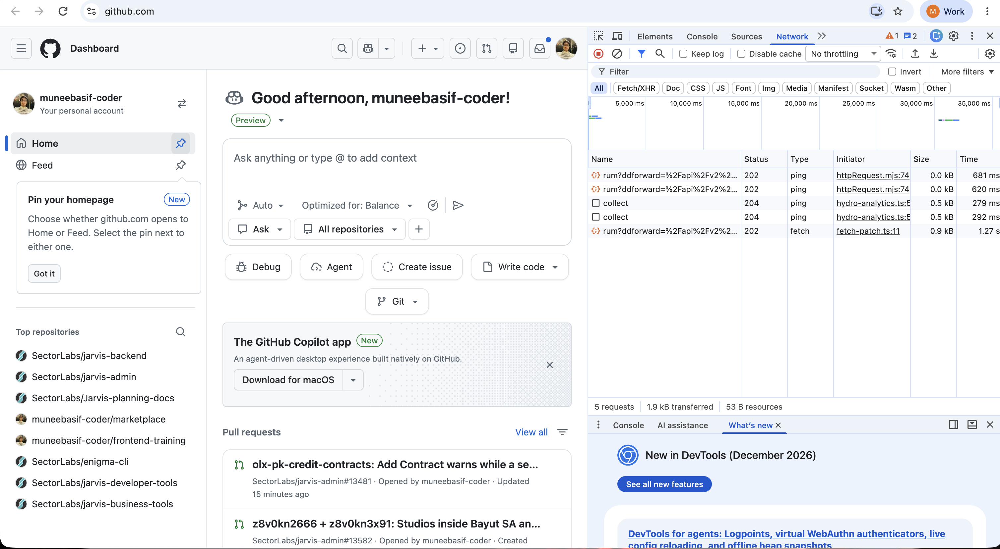
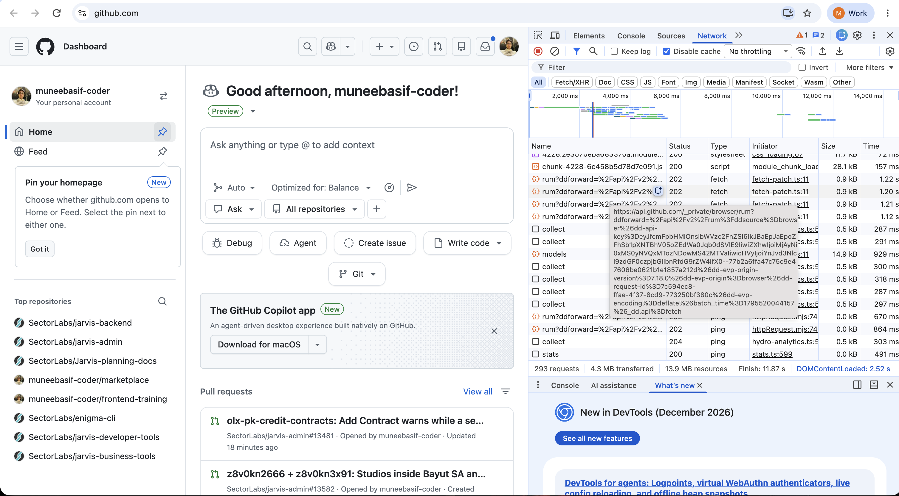
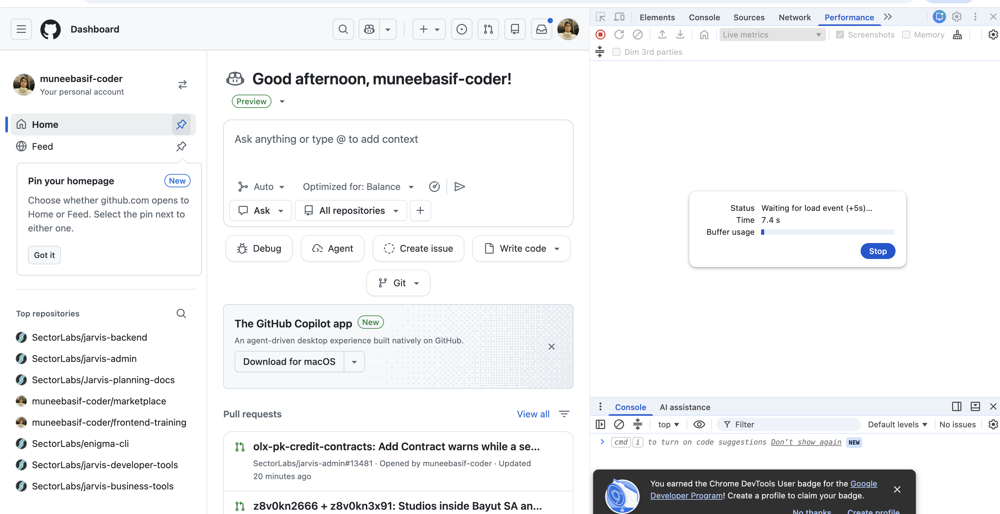

# Week 1 / Day 1 - How the web and the browser work

**Date:** Mon 23 Nov 2026
**Module:** Week 1: Basics: the web platform and JavaScript

Day 1 was mostly about what actually happens between typing a URL and seeing the page. Coming from backend, the network side (DNS, TCP, headers) was familiar, but I had never really looked at what the browser does once it gets the HTML back. That part was the most useful for me.

Rough flow I wrote down before going topic by topic:

```
URL -> DNS lookup -> TCP handshake -> TLS handshake -> HTTP request
    -> server responds (TTFB) -> parse HTML/CSS -> DOM + CSSOM
    -> render tree -> layout -> paint -> composite
```

---

## DNS

Browser only has the domain name, it needs an IP. It checks in this order:

1. Browser DNS cache
2. OS cache (and the hosts file)
3. Recursive resolver (ISP, or something like 1.1.1.1 / 8.8.8.8)
4. If the resolver doesn't have it cached: root server -> TLD server (`.com`) -> authoritative nameserver for that domain, which gives back the actual record

Records I should know: `A` (IPv4), `AAAA` (IPv6), `CNAME` (alias to another name).

Every record has a TTL which decides how long it stays cached. So when people say DNS changes "take time to propagate", it's really just caches expiring.

A cold lookup can easily cost tens of ms or more, which is why these exist:

```html
<link rel="dns-prefetch" href="https://cdn.example.com">
<link rel="preconnect" href="https://api.example.com">
```

`dns-prefetch` only does the DNS lookup early. `preconnect` does DNS + TCP + TLS early.

## TCP and TLS

TCP is the reliable part. Before any data, a 3 way handshake: `SYN -> SYN-ACK -> ACK`. That's one full round trip just to open the connection.

For HTTPS, TLS runs on top of that:
- Client hello (TLS version, ciphers it supports)
- Server hello + certificate
- Both sides agree on keys, everything after that is encrypted

TLS 1.2 needs 2 round trips for this, TLS 1.3 brought it down to 1 (and 0-RTT when resuming an old session). The certificate is signed by a CA the browser already trusts, that's how it knows it's really talking to that domain.

So on a fresh HTTPS connection you pay DNS + 1 RTT (TCP) + 1-2 RTT (TLS) before the actual request even goes out. That's why connection reuse (keep-alive) matters, and why HTTP/2 sending everything over one connection helped so much. HTTP/3 runs on QUIC (over UDP) and combines the transport and TLS handshake into one.

## Critical Rendering Path

Steps the browser takes from HTML bytes to pixels on screen:

1. Parse HTML -> **DOM**
2. Parse CSS -> **CSSOM**
3. Combine both into the **render tree**. Only things that will be visible are in it. `display: none` is not in it, `visibility: hidden` is (it still takes up space).
4. **Layout** (reflow): work out the size and position of every node
5. **Paint**: fill in the pixels, text, colors, borders, shadows
6. **Composite**: draw the layers on screen in the right order

Optimizing the CRP basically comes down to three things: fewer critical resources, fewer bytes, fewer round trips to fetch them. In practice: inline the critical CSS, load the rest later, don't let JS block the parser.

Something I noted down: changing `width`, `height`, `top` etc. triggers layout again which is expensive. Changing `color` is only a repaint. `transform` and `opacity` can be handled by the compositor alone, which is why animations should use those.

## DOM and CSSOM

DOM is the tree built from HTML. It's built incrementally as bytes arrive, so the browser can start working before the whole document is downloaded.

CSSOM is the tree built from CSS. The difference is CSSOM can't be used half done, because a rule further down can override something above it (cascade). So the browser waits for the full CSS before rendering, and that's exactly why CSS is render-blocking.

JS can read and change both. That's where the blocking problem comes from.

## Blocking vs non-blocking

- **CSS is render-blocking.** Nothing paints until the CSSOM is ready. For CSS that isn't needed right away you can use the `media` attribute so it doesn't block, e.g. `<link rel="stylesheet" href="print.css" media="print">`.
- **A normal `<script>` is parser-blocking.** HTML parsing stops, script downloads, runs, then parsing continues. And if there's a stylesheet still loading, the script waits for that too, since the script might ask for computed styles.
- **`async`**: downloads in parallel, runs as soon as it's downloaded (parsing pauses at that moment). Order is not guaranteed. Fine for independent stuff like analytics.
- **`defer`**: downloads in parallel, runs after HTML is fully parsed, in order, before `DOMContentLoaded`. Good default for app scripts.
- `type="module"` scripts are deferred by default.

```html
<script src="app.js"></script>              <!-- blocks the parser -->
<script async src="analytics.js"></script>  <!-- runs whenever it's ready -->
<script defer src="main.js"></script>       <!-- runs after parsing, in order -->
```

Same idea applies to JS code itself. There's one main thread, so a long running sync task blocks rendering and user input until it finishes.

## Rendering techniques

- **CSR (client side rendering)**: server sends an almost empty HTML + a JS bundle, JS builds the page in the browser. Typical React SPA. Navigation is fast after the first load, but first paint is slow and SEO suffers if the crawler doesn't run JS.
- **SSR (server side rendering)**: server renders full HTML on every request, so content shows up right away. Then JS **hydrates** it to make it interactive. Better first paint and SEO, but more load on the server and TTFB can go up.
- **SSG (static site generation)**: HTML is generated at build time and served from a CDN. Fastest option, but data is only as fresh as the last build. Good for docs, blogs, marketing pages.
- **ISR (incremental static regeneration)**: Next.js thing. Static pages that get regenerated in the background after a set time. Middle ground between SSG and SSR.

The hydration part was interesting to me. The page can look ready but not respond to clicks until the JS finishes, and that gap is what users actually feel as "laggy".

## Same-origin policy

Origin = **scheme + host + port**. All three have to match.

| URL A | URL B | Same origin? |
|---|---|---|
| `https://example.com` | `http://example.com` | No, scheme |
| `https://example.com` | `https://api.example.com` | No, host |
| `https://example.com` | `https://example.com:8080` | No, port |
| `https://example.com/a` | `https://example.com/b` | Yes, path doesn't matter |

The browser stops JS on one origin from reading responses from another origin. The request can still go out, it's reading the response that gets blocked. Embedding is allowed though, so ``, `<script src>`, `<link>` from other origins load fine.

CORS is how the server opts in. It sends `Access-Control-Allow-Origin` (and related headers) to say which origins can read the response. For "non-simple" requests (PUT/DELETE, custom headers, `Content-Type: application/json`) the browser first sends a **preflight** `OPTIONS` request to ask permission.

I've configured this from the Rails side with `rack-cors` before, but it clicked now that the browser is the one enforcing it, not the server. Calling the same API from Postman or curl works fine because there's no browser in the middle.

## Cookies

Small key-value data (around 4KB) that the server sets with `Set-Cookie`, and the browser sends back automatically with every request to that domain. That's the main difference from other storage: cookies go to the server, the rest don't.

Attributes:
- `Expires` / `Max-Age`: without one of these it's a session cookie and goes away when the browser closes
- `Domain`, `Path`: which requests it gets sent with
- `Secure`: only sent over HTTPS
- `HttpOnly`: JS can't read it through `document.cookie`. Important for session cookies because of XSS.
- `SameSite`: `Strict`, `Lax` (default in Chrome now), or `None` (must also be `Secure`). This is what helps against CSRF.

Since cookies go with every request (including images and static files on that domain), keep them small.

## Storage

| | localStorage | sessionStorage | IndexedDB | Cookies |
|---|---|---|---|---|
| Size | ~5MB | ~5MB | much larger, depends on disk | ~4KB |
| Lives until | cleared manually | tab is closed | cleared manually | expiry |
| Sent to server | No | No | No | Yes |
| API | sync, strings only | sync, strings only | async, stores objects | `document.cookie` |

- All of these are scoped per origin. sessionStorage is also per tab, so the same site open in two tabs has two separate sessionStorages.
- localStorage is synchronous, so big reads/writes block the main thread. You need `JSON.stringify` / `JSON.parse` for objects.
- Any JS on the page can read localStorage, so it's not a great place for auth tokens (XSS again). An `HttpOnly` cookie is safer for that.
- There's also the Cache API (Cache Storage), mainly used by service workers.

## Network Tab

What I went through in DevTools > Network:

- **Disable cache** and **throttling** (Fast 4G / Slow 4G) to see how the page behaves on a slow network with a cold cache
- **Preserve log** so requests don't get cleared on navigation
- Filters for Fetch/XHR, JS, CSS, Img, Doc, etc.
- Clicking a request: **Headers** (request + response headers, status code), **Preview/Response**, **Initiator** (what triggered this request), **Timing**
- **Timing** breakdown: Queueing, Stalled, DNS Lookup, Initial connection, SSL, Request sent, **Waiting for server response** (TTFB), Content Download. This maps directly to everything above.
- **Size** column shows `(memory cache)` / `(disk cache)` when it didn't hit the network, otherwise transferred size vs actual size (difference = compression)
- **Waterfall** makes it easy to spot request chains, e.g. HTML -> CSS -> font, each waiting on the previous one
- Bottom bar: total requests, transferred size, and `DOMContentLoaded` / `Load` times (the blue and red lines on the waterfall)

## Cache-Control

Response header that tells the browser (and CDNs/proxies) how to cache.

- `max-age=3600`: fresh for 1 hour, no request at all in that time
- `no-cache`: can store it, but must check with the server before every use. Confusing name, it doesn't mean "don't cache".
- `no-store`: don't store it anywhere. For sensitive data.
- `public` / `private`: `private` means only the user's browser can cache it, not shared caches like a CDN
- `s-maxage`: max-age just for shared caches
- `immutable`: this will never change, don't even revalidate
- `stale-while-revalidate=60`: serve the stale copy now, refresh in the background

**Revalidation:** browser sends `If-None-Match` with the `ETag` it has (or `If-Modified-Since` with `Last-Modified`). If nothing changed the server returns `304 Not Modified` with no body. Saves the download but still costs a round trip.

Common setup:
- Hashed static files (`main.a1b2c3.js`): `Cache-Control: max-age=31536000, immutable`
- HTML: `Cache-Control: no-cache`, so you always get the latest HTML, which points to the new hashed files after a deploy

## Latency and TTFB

**Latency** is how long it takes data to travel from A to B. Mostly comes from physical distance and the number of round trips (RTT = round trip time). **Bandwidth** is how much data can go at once. For web pages latency usually hurts more than bandwidth, since a page is a lot of small requests and each one needs round trips. More bandwidth doesn't make a round trip shorter.

Ways to cut latency: CDN (server closer to user), fewer requests, reusing connections, `preconnect`, HTTP/2 and HTTP/3, caching.

**TTFB (Time to First Byte)**: time from starting the request until the first byte of the response comes back. It includes redirects, DNS, connection, TLS and the server's own processing time. web.dev puts a "good" TTFB at 0.8s or less.

A slow TTFB is usually a slow backend (heavy DB queries, nothing cached), a server far from the user, or redirect chains. This is the part I relate to the most from backend work. A slow query shows up directly here, before the browser can do anything at all.

---

## DevTools exercise

Tried this on github.com (home page, logged in) with DevTools docked on the right.

### Network tab, before reload



I opened DevTools after the page had already loaded, so only 5 requests showed up: `rum?ddforward=...` (Datadog RUM, 202) and `collect` (GitHub's analytics, 204 No Content). These are just background beacons, nothing to do with rendering the page. Network tab only records while it's open, so to see the real page load you have to reload with it open.

### Network tab, hard reload with cache disabled



Ticked **Disable cache** and did a hard reload (`Cmd+Shift+R`), no throttling:

- **293 requests** for one page
- **4.3 MB transferred vs 13.9 MB resources.** The gap is compression (gzip/brotli). Transferred is what came over the wire, resources is the size after decoding.
- **DOMContentLoaded: 2.52s**
- **Finish: 11.87s.** This isn't a load metric, it's just when the last request finished. Analytics pings that keep firing later push it out.
- In the overview most of the bars sit between ~2s and 6s, then a few small ones around 10 to 12s, which are those late beacons.
- The **Initiator** column was the useful one for me. JS chunks like `chunk-4228-...js` come from `module_chunk_loader` (code splitting, loaded when needed), one stylesheet was injected by JS (`css_loading`), and the RUM calls go through `fetch-patch.ts`.

### Performance trace



Used **Record and reload** in the Performance panel. This is while it was still recording: it reloads the page, waits for the load event plus 5s more, then stops on its own. At 7.4s it was still on "Waiting for load event (+5s)", so on this page the load event fires late because of how many requests there are.

---

## Self check answers

**1. What happens when you type a URL and press enter?**
DNS resolves the domain to an IP, TCP handshake, TLS handshake (for HTTPS), browser sends the HTTP request, server responds. Browser parses HTML into the DOM, fetches CSS/JS it finds along the way, builds the CSSOM, combines them into the render tree, then layout, paint, composite.

**2. Why is CSS render-blocking but JS parser-blocking?**
CSS can't be applied partially because of the cascade, so the browser won't render until the full CSSOM is built. JS can change the DOM (even `document.write`), so the parser has to stop and run it before it can continue safely.

**3. Difference between `async` and `defer`?**
Both download without blocking the parser. `async` runs as soon as it's downloaded, in any order. `defer` waits until HTML parsing is done and runs in document order.

**4. `no-cache` vs `no-store`?**
`no-cache` stores the response but revalidates with the server every time before using it. `no-store` doesn't store it at all.

**5. Are `https://site.com` and `https://site.com:443` the same origin?**
Yes. 443 is the default port for HTTPS, so they're the same scheme, host and port.

**6. Where would you store an auth token, cookie or localStorage?**
An `HttpOnly`, `Secure`, `SameSite` cookie. JS can't read it so an XSS can't steal it. localStorage is readable by any script on the page.

**7. What is TTFB and what makes it slow?**
Time until the first byte of the response arrives. It covers redirects, DNS, TCP, TLS and server processing. Usually slow because of backend processing (queries, no caching), distance to the server, or redirects.

**8. `display: none` vs `visibility: hidden` in the render tree?**
`display: none` is left out of the render tree completely, no space taken. `visibility: hidden` is still in it and still takes up space in layout, just not painted.

**9. Why prefer `transform` / `opacity` for animations?**
They can be done on the compositor without triggering layout or paint again, so the animation stays smooth even when the main thread is busy.

**10. Why did TLS 1.3 make page loads faster?**
The handshake goes from 2 round trips to 1, and resumed connections can send data with 0-RTT. Fewer round trips before the first request.
