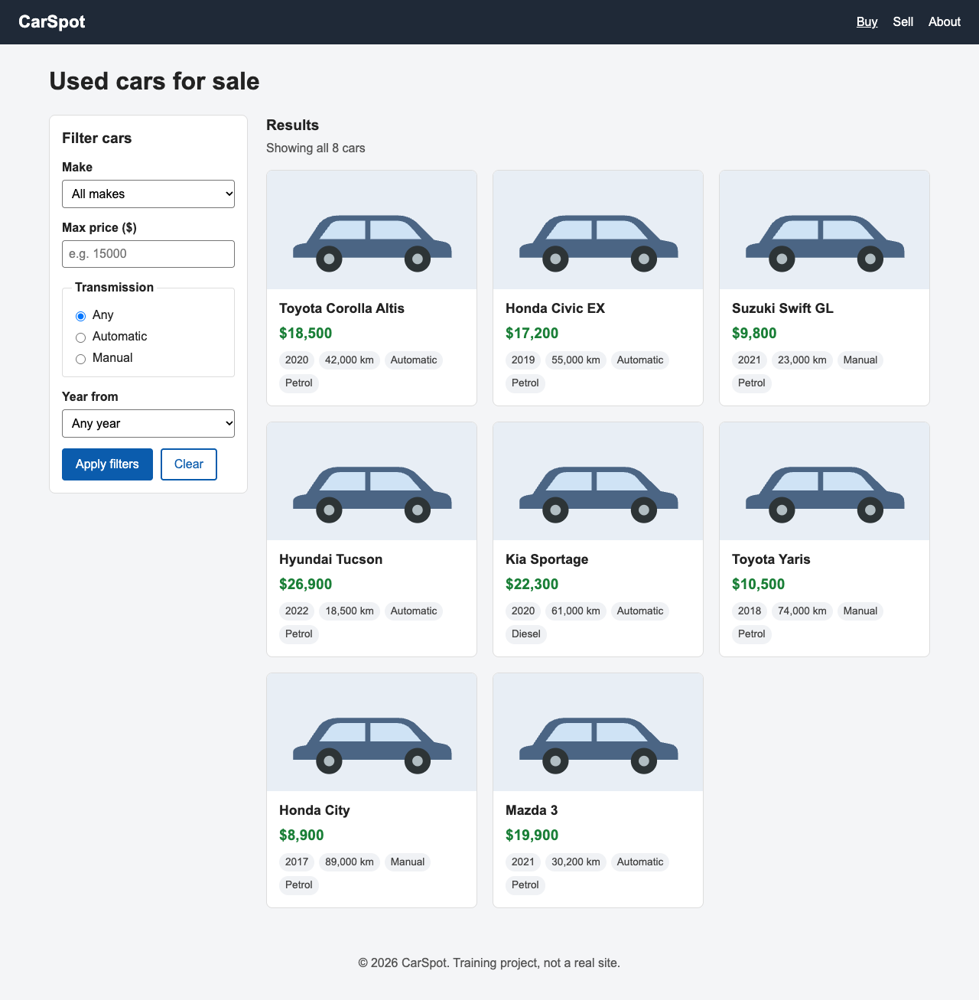
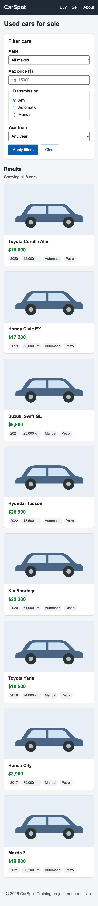
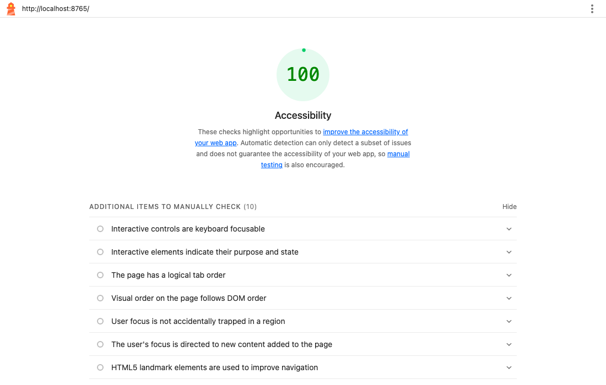

# Week 1 / Day 2 - Accessible car listings page

**Task:** A static car listings page with a semantic header and main, a labelled filter form, and a card grid that collapses to one column on a phone. Score 90+ on Lighthouse accessibility. Then use it with the keyboard only and listen to a card with a screen reader.

Code is in [`car-listings/`](car-listings/). No framework, just HTML, CSS and a small JS file for the filters. To run it, open `car-listings/index.html` in the browser, or `npx serve car-listings` from this folder.

## What I did and why

**Page structure**
- `header` (logo + `nav`), `main`, `footer`. These become landmarks, so a screen reader user can jump straight to them.
- Nav has `aria-label="Main"`, and the current page link has `aria-current="page"`.
- A **skip link** is the first thing on the page. It's hidden until it gets focus, then it jumps to `main`, so keyboard users don't have to tab through the header every time.
- Headings go in order: one `h1` (Used cars for sale), an `h2` for the filter and for the results, an `h3` for each car. I didn't skip levels just to get a smaller font.

**Filter form**
- Every input has a real `<label for="...">`. A placeholder isn't a label, it disappears when you type.
- The transmission radios are in a `fieldset` with a `legend`. That way the screen reader says "Transmission, group" and not just "Any, radio button".
- The form has `aria-labelledby` pointing to its heading, which makes it a named form landmark.
- The result count (`Showing 2 of 8 cars`) has `aria-live="polite"`. After you apply a filter the screen reader reads out the new count without moving focus.
- The buttons are real `<button>` elements (submit and reset), not divs with click handlers. Enter and Space work on them for free.

**Cards**
- The cards are in a `ul`, so VoiceOver says "list, 8 items" and you know how many there are.
- Each card is an `article`, and the car name is a heading with a link inside it. That gives one tab stop per card, and the link text is the car name, not a "View details" repeated 8 times.
- The car picture is the same generic drawing on every card, so it's decorative and has `alt=""`. If these were real photos the alt would describe the car, something like "White Toyota Corolla, front view".
- When filtering I hide the `li` with the `hidden` attribute (not just the article). That keeps the list item count right for screen readers too.

**Focus and contrast**
- `:focus-visible` gets a thick orange outline so you can always see where you are with the keyboard. I didn't remove the outline anywhere.
- I checked the text colors for contrast (4.5:1 minimum for normal text). The lowest one I used is the green price, about 5:1 on white.

**Tab order**

Skip link -> logo -> Buy / Sell / About -> Make -> Max price -> Transmission (one tab stop, arrow keys move between the radios) -> Year from -> Apply filters -> Clear -> then each car name link, one by one, in the same order as on screen.

## Responsive

The grid uses `repeat(auto-fill, minmax(240px, 1fr))`, so it fits as many columns as there's room for. Under 700px a media query forces the filter and the grid into a single column.

| Desktop | Phone (390px) |
|---|---|
|  |  |

## Lighthouse

Accessibility score 100. Worth noting that Lighthouse itself lists "additional items to manually check" under the score (tab order, focus not trapped, landmarks, etc). It can only check what's automatic, like labels, alt text, contrast and ARIA. That's the reason for the keyboard and screen reader part of this task.
